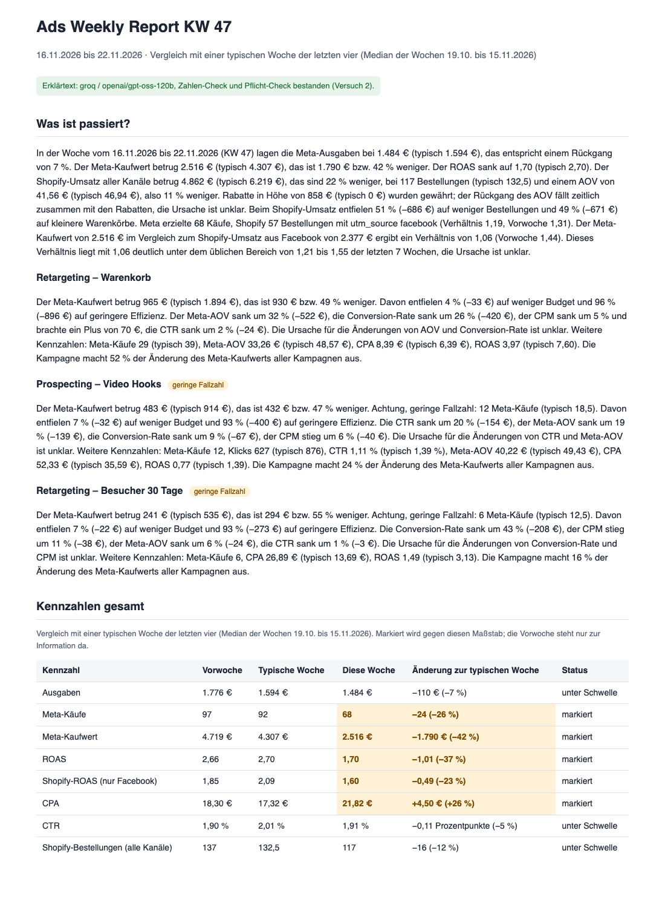

# Ads Weekly Report

**Prototype (Version 1).** A weekly report that explains, in plain language, what changed in a small online shop's Meta Ads and Shopify numbers compared with a typical week, and why.



## Example reports

Three reports with LLM text, one per event planted in the sample data. They open as web pages:

- [Calendar week 45](https://iremleyla.github.io/ads-weekly-report/beispiel/kw45.html)
- [Calendar week 46](https://iremleyla.github.io/ads-weekly-report/beispiel/kw46.html)
- [Calendar week 47](https://iremleyla.github.io/ads-weekly-report/beispiel/kw47.html)

Look at the example reports first and see what the report finds on its own. Only then read the solution in [docs/TESTLOESUNG.md](docs/TESTLOESUNG.md).

## Why German?

The reports are in German because the tool is built for small online shops in the DACH region (Germany, Austria, Switzerland). The code, comments and variable names are in German too. This README is in English so that more people can read it.

## Goal

Shop owners see a lot of numbers every week, but rarely a clear answer to the question: what happened, and what should I do? This report answers exactly that, on one page and in plain language.

## Core rule

The LLM only explains numbers that were calculated and checked by the code beforehand. Every number in the text must appear in the table of checked values. If a cause is unclear, the report says „unklar“ (unclear) instead of guessing.

## How it works

1. Read the CSV exports from Meta Ads and Shopify and group them into weeks (Monday to Sunday).
2. Compare each week with a **typical week**: the median of every total over the previous 4 weeks. Ratios such as ROAS, CPA and CTR are calculated from these totals. With fewer than 4 earlier weeks, the report compares with the previous week and says so.
3. Mark strong changes with fixed rules (thresholds and minimum sizes in `einstellungen.py`). Split changes into drivers, for example Meta purchase value = spend ÷ CPM × CTR × conversion rate × AOV. Group the marks per campaign and rank them by their effect in euros.
4. Show the difference between Meta purchases and Shopify orders with `utm_source=facebook`. Neither number is treated as "the correct one".

   Two kinds of Shopify numbers appear in the report, and they are labelled as such:
   - **„alle Kanäle“ (all channels):** Shopify revenue, orders, AOV and discounts count every order in the shop.
   - **„nur Facebook“ (Facebook only):** the Meta vs. Shopify comparison and the Shopify ROAS only use orders with `utm_source=facebook`.
5. An LLM writes the explanation from checked facts only. Every number carries an ID (for example `[B2.3]`). The code then runs three checks:
   - **number check:** every number matches its ID,
   - **direction check:** words like „stieg“ (rose) or „sank“ (fell) match the sign of the number,
   - **mandatory-statement check:** statements such as „unklar“ or „geringe Fallzahl“ (small sample) are not dropped.

   If the text fails twice, the report uses a fallback text built by the code.
6. Output: a one-page HTML report.

## Folder structure

```
ads-weekly-report/
├── data/
│   ├── meta_ads_export.csv        sample Meta Ads Manager export (8 weeks, 4 campaigns, daily)
│   └── shopify_orders_export.csv  sample Shopify orders export (8 weeks)
├── einstellungen.py               all thresholds, paths and LLM settings in one place
├── daten.py                       step 1: read CSVs, group into weeks (Mon–Sun)
├── analyse.py                     steps 2–4: metrics, typical-week comparison, rules, drivers, findings, Meta vs. Shopify
├── llm_text.py                    step 5: table of checked values, number/direction/mandatory checks, LLM call, fallback text
├── report.py                      step 6: one-page HTML report
├── beispiel/                      three example reports with LLM text (KW 45, 46, 47)
├── docs/
│   ├── screenshot_kw47.png
│   ├── CLAUDE.md                  working rules given to Claude Code
│   ├── START_PROMPT.md            first prompt given to Claude Code
│   └── TESTLOESUNG.md             what happens in the sample data (read after the examples!)
├── reports/                       output (not committed)
│   ├── report_KW…html
│   ├── laeufe/                    every LLM run as a readable Markdown file
│   └── zahlencheck_fehler.log     every failed check with the type of error
├── requirements.txt               tested package versions
├── LICENSE                        MIT
├── .env.example                   template for .env (API keys)
└── .env                           your keys (never committed)
```

All data is made up. Real customer data never belongs in this repository.

## Usage

One-time setup:

```bash
python3 -m venv .venv
.venv/bin/pip install -r requirements.txt
cp .env.example .env      # then add GROQ_API_KEY and/or ANTHROPIC_API_KEY
```

Create a report:

```bash
.venv/bin/python report.py                     # latest week, with LLM text
.venv/bin/python report.py --ohne-llm          # no API call, fallback text
.venv/bin/python report.py --woche 6           # sixth week in the data (counted from 1)
.venv/bin/python report.py --woche 2026-11-04  # the week containing this date
.venv/bin/python report.py --alle --ohne-llm   # all weeks from week 2
```

Reports are written to `reports/`. Reports without LLM are named `…_ohne-llm.html`.

Check individual parts:

```bash
.venv/bin/python daten.py               # weekly tables
.venv/bin/python analyse.py             # comparison, marks, decompositions, findings
.venv/bin/python llm_text.py            # tests without API (number, direction and mandatory checks, flow)
.venv/bin/python llm_text.py --modelle  # models offered by the configured provider (free)
.venv/bin/python llm_text.py --echt     # one real LLM run for the latest week
```

Switch provider and model in `einstellungen.py` (`LLM_ANBIETER`, `LLM_MODELLE`).

## Known limitations

**Checking the LLM text**

- The number check makes sure every number matches its ID in the table of checked values (ignoring the sign). It does not check whether the sentence describes the number correctly. "The budget cost 784 € [B2.23]" would pass even if B2.23 is the efficiency effect.
- The direction check compares direction words („stieg“, „sank“, „mehr“, „weniger“ …) with the sign of the ID. It uses word lists and clauses, not grammar. A word outside parentheses does not apply to a number inside them („der CPM stieg um 6 % (−40 €)“ is correct). Because of that, an error in exactly this form slips through: „Die Effizienz sank beim CPM um 5 % (+70 €)“ in a single clause. In a list („sank bei der CTR um …, beim CPM um 5 % (+70 €)“) it is caught. Verbs and nouns missing from the word list are not checked. The list (with German word endings such as „erhöht“ → „erhöhtes“) has already been extended three times after false alarms in real runs.
- The direction check is deliberately strict: „Der CPM sank um 5 % und brachte dadurch +70 €“ fails although it is correct, because „sank“ is the only direction word in the sentence. At worst this costs one attempt.
- The mandatory-statement check only looks for keywords („unklar“, „nicht berechenbar“, „geringe Fallzahl“, „zeitlich zusammen“, „Verhältnis“). It does not check the sentence around them. A keyword can also be satisfied by another sentence: in tests, „unklar“ from the discount sentence hid a missing Meta vs. Shopify part, which is why the more specific keywords were added. An invented cause without a number is not detected automatically, and neither is a dropped sentence without a keyword. Always read the text yourself.
- Campaign names are removed exactly before the number check (because of the 30 in „Besucher 30 Tage“). If the LLM spells a name differently, the number fails as „ID fehlt“ (ID missing). That is safe but costs an attempt.
- The notes "which number is correct cannot be told from the data" and "before/after discount depends on the Meta pixel setup" are written into the report by the code, because the LLM regularly dropped them in tests.

**Analysis**

- The decomposition says which building block moved (for example the conversion rate), not why. Causes are therefore shown as „unklar“.
- If a building block is 0 in one of the two weeks, the decomposition is „nicht berechenbar“ (not computable). The finding is still ranked by its change in purchase value.
- The benchmark is a typical week of the last 4 weeks (median of every total, ratios calculated from them). The typical week is constructed, not a real week: the medians can come from different weeks. Meta total is the sum of the campaigns' typical weeks, so that "total = sum of campaigns" holds.
- Until 4 earlier weeks exist, the report compares with the previous week (noted in the report).
- A lasting change becomes "typical" itself after 4 weeks and is then no longer flagged. The report knows no seasonal patterns (for example the previous year).
- Noise: deliberately not solved in Version 1. Each week, 2 to 4 findings are explained, even in weeks without a real event. The cause is the small numbers per campaign (10 to 50 purchases per week): with so few purchases, the purchase value often moves by more than 20 % by chance. Using the median as the benchmark did not change this. Read findings marked „geringe Fallzahl“ with care.
- Discounts: if the Shopify AOV is marked and there were discounts that week, the text only mentions this as a coincidence in time („fällt zeitlich zusammen mit Rabatten von …“), never as the cause. The data does not show whether the discounts lowered the AOV. The rule only works on the total, because Shopify has no campaigns.
- Thresholds and minimum sizes are fixed rules, not a statistical test. Small campaigns get the note „geringe Fallzahl“, which does not replace a significance test.
- Attribution via `utm_source` is incomplete. Orders whose link lost its UTM parameters, and customers who saw an ad but bought later through another path (direct visit, search, newsletter), are not counted as „facebook“. The Facebook-only numbers (Meta vs. Shopify, Shopify ROAS) therefore tend to undercount orders that came from the ads. They do not show the true effect of the ads.
- Shopify knows no campaigns. Meta vs. Shopify is therefore only compared in total and only judged from 6 earlier weeks on. With few weeks, the range is still narrow.
- Whether a week is complete is checked only in the Meta data (in Shopify, a day without orders looks like a missing day).

**LLM provider**

- Groq (free tier) allows 8,000 tokens per minute. The code therefore waits 60 seconds before the second attempt.
- Model names change: the originally planned Groq model no longer existed. Check with `python llm_text.py --modelle` before switching.
- The LLM text varies between runs. As of 18 Nov 2026 with `openai/gpt-oss-120b`: 5 of 6 runs passed on the first attempt, 6 of 6 on the second. With the direction and mandatory checks in their final form (20 Nov 2026), the three example reports each passed on the second attempt. Earlier runs that day fell back to the fallback text twice because of false alarms in the direction check; the word list was extended afterwards. This is a small sample.

## How this was built

This is a learning project, built step by step with Claude Code. The working rules it had to follow (for example: only checked numbers, „unklar“ instead of guessing, never pick Meta or Shopify as "the correct" number) are in [docs/CLAUDE.md](docs/CLAUDE.md). The first prompt is in [docs/START_PROMPT.md](docs/START_PROMPT.md). Both are kept unchanged as a record of how the project started.

## Later

- Direct connection to the Meta and Shopify APIs
- Automatic delivery every Monday by email
- Several shops at once

## License

MIT, see [LICENSE](LICENSE).
